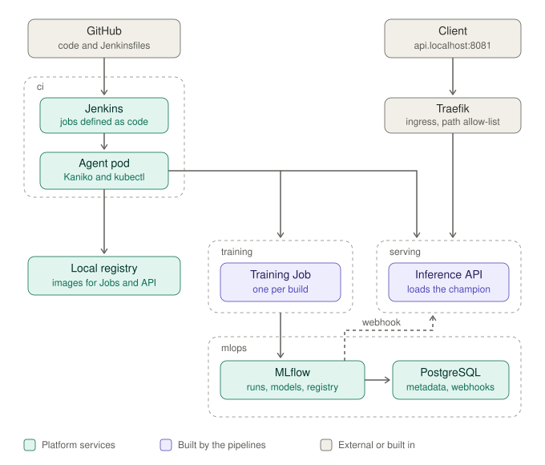

# mlops-platform

A local-first, end-to-end MLOps platform built entirely from code: from a `git push` to a model serving predictions behind an Ingress, on a Kubernetes cluster that can be destroyed and rebuilt with one command.

**Stack:** Terraform · Kubernetes (k3d) · Jenkins (Configuration as Code) · Kaniko · MLflow 3 · PostgreSQL · FastAPI · Traefik · Docker · uv

## Why this project exists

Most ML demos stop at a notebook. This project is about everything around the model: reproducible infrastructure, CI/CD for training and serving, a model registry as the contract between them, and the operational details that decide whether a system can be trusted (failure modes, rollbacks, least privilege, logging).

The model is deliberately simple (gradient boosting on the public Bank Marketing dataset), so the platform is the subject.

## How it flows




## Engineering decisions

- **The whole lifecycle is code.** Two Terraform stages: `cluster` (k3d and registry) and `platform` (everything inside). They are separate because the Kubernetes and Helm providers need a running cluster at plan time. `up.sh` waits for the API server before the second stage, and `down.sh` also works when the cluster is already stopped.
- **Jenkins is configured as code.** Job definitions live in `jenkins/jobs/*.groovy` (Job DSL via JCasC), pipeline logic in Jenkinsfiles. A new pipeline is two files and a `terraform apply`. The parameter form has one source of truth, so it cannot flip between two definitions.
- **Images are built without a Docker daemon.** Kaniko runs in ephemeral agent pods. The agent's service account has namespaced, least-privilege Roles: it can deploy to `serving` and run Jobs in `training`, and nothing else.
- **Image tags are content hashes.** The tag is a hash of exactly the files that go into the image. Unchanged content is never rebuilt, and one tag always identifies one image. Pipeline parameters are environment variables on the Job, so they never invalidate the image.
- **Tests gate the image.** A multi-stage Dockerfile runs the unit tests in a build stage that the runtime stage depends on. A failing test means no image. The runtime image runs as a non-root user.
- **The registry is the contract between training and serving.** The API loads `models:/bank-marketing@champion`. Training and serving never share a path, a file or a run id.
- **Models swap without a restart.** An MLflow webhook tells the API that an alias changed. The payload is treated as a hint only: the API re-reads the registry and decides itself, so a forged or duplicated request cannot inject a model. A failed reload keeps serving the current model.
- **Fail fast at startup, fail soft at runtime.** The API refuses to start without a champion, so a bad deploy never replaces a working pod. Once running, a registry outage does not take the service down.
- **Small public surface.** The Ingress is an allow-list of four paths. The reload and webhook routes are not routed from outside and are hidden from the API docs. In-cluster callers reach them through the Service.
- **Deploys are verified.** Each build deploys, waits for the rollout, runs a smoke test through the Service, and records the build number in the rollout history. A rollback runs only when the new version was deployed and failed its smoke test.
- **Logs are structured and safe.** Key-value lines with event names (`event=model_changed from_version=2 to_version=3`). Prediction logs carry the model version and latency and never the input data.

## Architecture

| Namespace | Purpose |
| --- | --- |
| `ci` | Jenkins controller and temporary build agents (Kaniko, kubectl) |
| `mlops` | MLflow 3 and its PostgreSQL backend, with persistent volumes |
| `training` | Training Jobs: one per build, deleted after the run |
| `serving` | The inference API, Service and Ingress |
| `monitoring` | Reserved for the observability stack (planned) |

The cluster is a single k3d node. Traefik, which ships with k3s, is the ingress controller. The local registry is reachable as `localhost:5001` from the laptop and as `mlops-registry.localhost:5000` from inside the cluster.

## Quick start

Prerequisites on WSL2 Ubuntu: Docker, kubectl, helm, terraform, k3d, uv (see [bootstrap.md](bootstrap.md)).

```bash
./scripts/up.sh      # cluster, registry, Postgres, MLflow, Jenkins (5 to 8 minutes)
./scripts/down.sh    # destroy everything, including the data
```

Open the UIs:

```bash
kubectl get secret -n ci jenkins -o jsonpath='{.data.jenkins-admin-password}' | base64 -d; echo
kubectl port-forward -n ci svc/jenkins 8080:8080      # http://localhost:8080  (user: admin)
kubectl port-forward -n mlops svc/mlflow 5000:80      # http://localhost:5000
```

The inference API needs no tunnel once it is deployed: http://api.localhost:8081/docs

Then, in Jenkins: run `training_jenkins_pipeline`, then `inference_jenkins_pipeline`. The inference service needs a registered `champion` model to start.

## Repository layout

| Folder | Contents |
| --- | --- |
| `infra/cluster/` | k3d cluster and registry definition, applied by Terraform |
| `infra/platform/` | Namespaces, Postgres, MLflow, Jenkins and RBAC (Terraform) |
| `scripts/` | `up.sh` and `down.sh` |
| `training/` | Training code, tests, Dockerfile, Kubernetes Job template |
| `inference/` | FastAPI service, tests, Dockerfile, Kubernetes manifests |
| `jenkins/` | Jenkinsfiles, the agent pod, and `jobs/` with the Job DSL definitions |
| `docs/` | [Command cheat sheet](docs/commands.md) and [learning notes](docs/learning/README.md) |

## Status

| Area | State |
| --- | --- |
| Cluster, registry and port mapping, rebuilt with one command | Built |
| MLflow 3 with PostgreSQL and an artifact volume | Built |
| Jenkins as code: JCasC, Job DSL, Kubernetes agents, Kaniko | Built |
| Training pipeline with content-hash image tags and test-gated builds | Built |
| Inference API, Ingress and pipeline (deploy, smoke test, rollback) | Built |
| Webhook-driven model reload, structured logging, fail-fast startup | Built |
| Promotion gate (register and set `champion` only if the model is better) | Planned, next |
| Streamlit UI | Planned |
| Monitoring: Prometheus, Grafana, Headlamp | Planned |
| Drift detection (Evidently) and retraining trigger | Planned |
| Champion vs challenger evaluation | Planned |
| Security hardening and scanning | Planned |
| Managed-Kubernetes variant of the cluster stage, GPU model extension | Later |

The rollback path is implemented but has not been exercised yet.

## Known limitations

These are deliberate scope decisions for a local project. Each one has a production answer.

- **Promotion is manual until the gate exists.** Training logs models but does not register them, so the `champion` alias is set by hand on a fresh cluster.
- **The webhook is not signature-verified.** MLflow's request-forgery guard is relaxed (plain HTTP, private addresses) so that it can reach an in-cluster Service. That is acceptable behind a port-forward on a laptop. In production: HTTPS, a signing secret, and an authenticated MLflow.
- **No NetworkPolicies.** Any pod can call the internal endpoints. The fix is a separate admin port that only MLflow and Jenkins can reach.
- **Startup depends on MLflow.** This is the cost of failing fast. A production variant would cache the last good model on a volume.
- **A lost webhook is not recovered.** A polling fallback that compares the loaded version with the registry would close that gap and also cover several replicas.
- **Single node, local volumes, no backups.** `down.sh` destroys all data.

## Documentation

- [Command cheat sheet](docs/commands.md)
- [Learning notes](docs/learning/README.md): Kubernetes, Jenkins, MLflow, Terraform, with the pitfalls found while building this
- [Bootstrap guide](bootstrap.md): laptop setup from scratch
- [Terraform guide](infra/README.md)

## Author

Charudatta Pokale · [LinkedIn](https://www.linkedin.com/in/your-profile) · [GitHub](https://github.com/charudattapokale)
